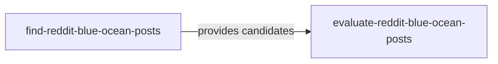

# 《Reddit 蓝海帖挖掘》— Skill Index

> 经 `cangjie-skill` 蒸馏并通过 V1/V2/V3 验证，共产出 2 个可执行技能。处理时间：2026-10-14。

## 来源

- **作者**：子木（公众号：写增长的子木）
- **发布日期**：2026-08-02
- **一句话主旨**：通过多路径发现与多信号硬门，找到低竞争、高外部价值且与业务和商业意图匹配的 Reddit 机会。
- **整文理解**：[BOOK_OVERVIEW.md](./BOOK_OVERVIEW.md)
- **验证记录**：[verified.md](./verified.md)

## 技能

1. [`find-reddit-blue-ocean-posts`](../../.agents/skills/find-reddit-blue-ocean-posts/SKILL.md) — 从 SERP、Top Pages、GEO、竞品与趋势建立可审计候选池。
2. [`evaluate-reddit-blue-ocean-posts`](../../.agents/skills/evaluate-reddit-blue-ocean-posts/SKILL.md) — 用实时证据和硬门把候选分成 confirmed、provisional、rejected。

## 关系图

## 推荐顺序

1. 没有 URL 时先运行 `find-reddit-blue-ocean-posts`。
2. 已有 URL 或候选表时直接运行 `evaluate-reddit-blue-ocean-posts`。
3. 只有评估结果为 `confirmed` 时，才进入回复策略或内容制作阶段。

## 审计轨迹

- [候选池](./candidates/)
- [淘汰记录](./rejected/)
- [测试夹具](./test-fixtures/)
