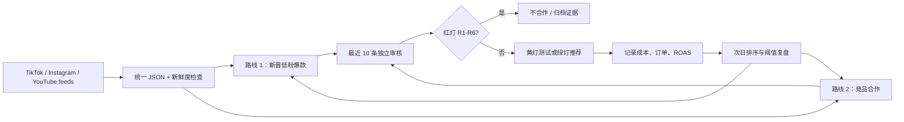

# Influencer Intelligence Flywheel

一个可审计、每天增量运行的“发现网红 → 筛选网红 → 推荐合作”系统。发现与判断是两个独立流程：高流量只能提高发现优先级，不能覆盖红灯淘汰。

## 两条发现路线

1. **新晋 / 低粉爆款**：粉丝量受控，同时最近 10 条的中位、均值或爆款播放/粉丝比明显高，或粉丝增长加速。
2. **已与竞品合作**：最近内容存在竞品 @、品牌 hashtag、付费合作标签、广告披露或多项商业信号，并保留帖子级证据。



## 本地运行

要求 Node.js 20+，无第三方运行依赖。

```powershell
cd influencer-intelligence
npm test
npm run daily -- --input fixtures/creators.json --date 2026-10-10
```

默认输出：

- `output/latest.md`：给运营看的日报。
- `output/latest.json`：完整证据、分数、红灯和推荐。
- `data/state/history.json`：最多 90 个日快照，含新增帖子、粉丝变化和发现分变化。

单独运行两个流程：

```powershell
npm run discover -- --input <file-or-directory>
npm run evaluate -- --input <file-or-directory> --offer-context authentic
```

`--offer-context` 支持 `authentic`、`private_label`、`replica`、`counterfeit`、`unverified`。不应把 `unverified` 改写为正品来规避 R1/R3。

`discover` 默认读取 `config/default.json`，也可传 `--config <path>`。输入 JSON 顶层若带有 `competitors` 数组，会与配置中的竞品库合并。`evaluate` 是单账号/指定名单审核，因此会审核全部输入；`daily` 才会先发现 shortlist，再只审核 shortlist。

## 每日数据接入

CLI 接受单个 JSON 或 JSON 目录，统一结构见 `schemas/creator.schema.json`。三个平台可混合输入；账号按 `platform:handle` 去重，帖子按 ID 去重。

已有 TikTok 引擎可作为 collector 使用：

```powershell
cd C:\Users\Administrator\Documents\GitHub\TikTok-Data-Engine
node src\hashtag\scrape_influencer_daily.js
```

推荐先使用 XHR hashtag 广扫，再只对候选账号补采最近 10 条。不要复制该项目的 `.env`、Cookie 或 `node_modules`。旧 collector 的 `authorStats` 粉丝字段需要先修正，采集失败必须作为错误上报，不能当作“0 个候选”。

在 GitHub Actions 中，每天北京时间 08:15 自动运行 `.github/workflows/influencer-intelligence-daily.yml`。至少配置一个授权 JSON feed：

- `TIKTOK_FEED_URL` / `TIKTOK_FEED_TOKEN`
- `INSTAGRAM_FEED_URL` / `INSTAGRAM_FEED_TOKEN`
- `YOUTUBE_FEED_URL` / `YOUTUBE_FEED_TOKEN`

feed 可返回 JSON 数组，或 `{ "creators": [...] }`。若一个 feed 都未配置，任务会明确失败，避免生成看似正常的空日报。

采集服务的每日查询词见 `config/source-queries.json`；竞品词从 `config/default.json` 统一维护，避免 TikTok、Instagram 和 YouTube 各自漂移。

## 判断和飞轮

- 红灯标准：`docs/influencer/INFLUENCER_RED_FLAG_NO_GO_STANDARD.md`。
- 项目 Skills：`.agents/skills/find-influencers` 与 `.agents/skills/evaluate-influencers`。
- 将真实投放结果按 `data/outcomes.example.json` 的格式保存到本地 `data/outcomes.json`。历史 ROAS 和订单只会调整非红灯候选的优先级，永远不能覆盖硬性否决。
- 每周复盘误报、漏报和转化结果后再修改 `config/default.json` 阈值；保留原始证据和版本，以便回溯。

## 输出决策

- `red`：不合作／红灯淘汰。
- `yellow`：仅低成本、可追踪、小额测试，先补齐证据。
- `green`：建议联系，但仍从分阶段测试开始。

发现分仅决定“先看谁”，判断结果决定“能不能合作”。
